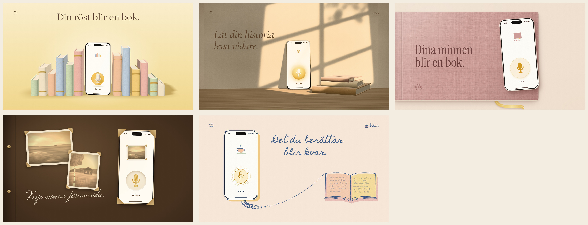

# Min berättelse: five visual concepts

Five 16:9 website mockups (3840×2160, rendered from 1920×1080 at 2×) for the service that turns spoken memories into a personal book. The primary user is an older person telling their life story. Children and grandchildren may buy it as a gift.

Each mockup should say, almost without reading: *I can speak here, and my memories can become a book.*



## The five concepts

| # | Name | Visual idea | Palette | Treatment | Microphone |
|---|------|-------------|---------|-----------|------------|
| 1 | **Hyllan** (The shelf) | A row of linen-bound books whose heights trace a spoken phrase, with the phone standing among them as the loudest moment. | Pastel: butter, rose, peach, sage, muted blue | **3D** | Sculpted cream ceramic microphone on a golden cushion, rendered in 3D |
| 2 | **Eftermiddag** (Afternoon) | Low summer sun through a mullioned window and leaves falls across a plaster wall, a phone leaning in the light and a stack of cloth books. | Sepia: honey, champagne, plaster, oak | **3D** | Softly glowing golden orb with a cream symbol and a halo |
| 3 | **Omslaget** (The cover) | The browser window is the cover of a dusty-rose linen book: the headline is debossed into the cloth and the phone rests on top. | Pastel: dusty rose, cream, butter ribbon | Flat, editorial | Bold, solid golden symbol on a pale butter pad |
| 4 | **Albumet** (The album) | A dark family-album page where the phone is mounted with photo corners beside two faded deckle-edged summer prints, captioned in white ink. | Sepia: umber page, faded prints, brass | Flat, editorial | Cream disc pressed into the screen with a gold-foil symbol |
| 5 | **Handstilen** (The handwriting) | A coiled telephone cord leaves the phone, loosens into handwriting loops and becomes the outline of an open book. | Pastel: peach paper, ink blue, butter, rose | Flat, line illustration | Fine golden outline inside thin sound rings |

Distribution: three pastel concepts (1, 3, 5) and two sepia concepts (2, 4). Exactly two are 3D: **Hyllan** (pastel) and **Eftermiddag** (sepia). Every phone screen is white or pale cream, and the large microphone sits low on the opening screen.

## Copy budget (visible words per mockup)

Status-bar digits (9:41) are not counted.

| # | Sentence (3–5 words) | Extra standalone words (max 2) |
|---|----------------------|--------------------------------|
| 1 | Din röst blir en bok. | Berätta |
| 2 | Låt din historia leva vidare. | Gåva, Berätta |
| 3 | Dina minnen blir en bok. | Tryck |
| 4 | Varje minne får en sida. | Berätta |
| 5 | Det du berättar blir kvar. | Gåva, Börja |

"Gåva" (gift) is the single cue aimed at children and grandchildren buying the book for someone. "Tryck" in concept 3 means both *press* and *print*. Book covers are left unlettered.

## Brainstorm: directions explored

Explored before choosing, roughly in order of how the relationship between voice and book is shown:

1. **The voice becomes books.** Book heights form a waveform. → *Hyllan*
2. **Light and time.** A still life in late sun, with memory carried by light rather than objects. → *Eftermiddag*
3. **Scale shift.** The page is the book's cover and the phone rests on it. → *Omslaget*
4. **The voice joins the family album.** The phone is mounted like a photograph. → *Albumet*
5. **The voice becomes handwriting.** A telephone cord turns into script and then a book. → *Handstilen*
6. A bookmark ribbon that undulates like a waveform from the phone into the pages. Folded into *Omslaget* as the butter ribbon.
7. A gift-wrapped book with the phone tucked under the ribbon. Kept as the "Gåva" cue instead, to avoid a sixth object.
8. A leporello (concertina book) unfolding from the phone in a zigzag. Too close to the waveform idea in *Hyllan*.
9. Pages fanning open in a wave. Hard to read at a glance.
10. A porcelain cup and saucer for the *fika* moment of telling stories. Reduced to the small cup icon in *Handstilen*'s app.
11. A phone hidden in a hollowed-out book. Rejected: it reads as a hiding place, not a keepsake.
12. A full-bleed faded summer photograph as the page. Its colours live on in *Albumet*'s prints and *Eftermiddag*'s light.

## Implementation notes

The prototype is at https://min-berattelse-prototyp.thommeand.chatgpt.site/. It is a working phone simulation: it records audio, sends it to OpenAI automatically when recording stops, then shows the text for review and saving. Swedish is the default. Nothing here modifies it. These mockups only cover the opening screen, and every concept keeps the phone as real HTML so the simulation can be dropped in unchanged:

- **Flat concepts (3, 4, 5).** The phone is an HTML element (`shared/phone.css`). The `.app` area is where the existing recording UI mounts.
- **3D concepts (1, 2).** The phone body, books, wall and light are Three.js. The screen is HTML placed into the 3D scene with `CSS3DRenderer` (`shared/three-kit.js`), so it stays crisp, clickable and accessible rather than becoming a texture. Concept 1's sculpted microphone is rendered once in WebGL and used as the button image.
- Every status bar shows signal and Wi-Fi glyphs, and nothing suggests the app works offline. Transcription needs a connection.
- The guided questions and the review/save screens can keep the text they need. The copy budget applies to the opening composition only.

## Rendering

```sh
npm install
npm run render            # all five → mockups/*.jpg
node render.mjs 02        # just one concept
```

`render.mjs` serves this folder locally and screenshots each `concepts/<id>/index.html` in headless Chromium (Playwright) at 1920×1080, device scale 2. All textures (linen, paper, wood, grain, faded photographs, the window light) are generated in code with fixed seeds, so renders are repeatable.

Fonts are OFL-licensed and installed through `@fontsource`: Fraunces, Cormorant Garamond, Instrument Serif, Nunito, DM Sans, Homemade Apple and Mrs Saint Delafield.
